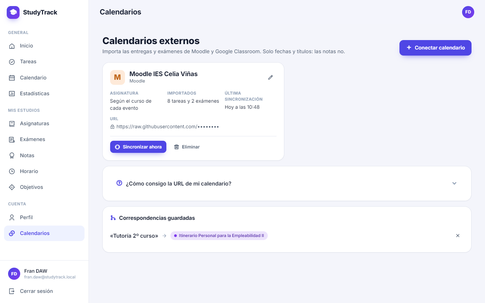

# StudyTrack

Aplicación web para que los estudiantes gestionen su curso en un solo lugar:
asignaturas, tareas, exámenes, notas, horario, objetivos y estadísticas.

Está hecha con **PHP 8 y MySQL, sin frameworks**, con un diseño *mobile-first*
que funciona igual de bien en el móvil que en el ordenador, con tema claro y oscuro.


## Funcionalidades

| Sección | Qué puedes hacer |
| --- | --- |
| **Inicio** | Resumen del día: tareas para hoy y atrasadas, exámenes de la semana, «Hoy en clase» (la clase de ahora y la siguiente), cuenta atrás del próximo examen, progreso académico (media general), resumen semanal y últimas notas. |
| **Asignaturas** | Crear, editar y borrar asignaturas con profesor, curso y color (paleta o color libre). Cada tarjeta muestra la media, las tareas pendientes y el próximo examen; el detalle reúne sus tareas, exámenes, notas y horario. |
| **Tareas** | Tareas con asignatura opcional, fecha límite, prioridad y estado. Pestañas (hoy, próximos 7 días, atrasadas), filtros, búsqueda y completar en un clic. Se resaltan las vencidas y las de hoy. |
| **Exámenes** | Próximos exámenes con cuenta atrás y exámenes pasados. Un examen realizado tiene el botón «Añadir nota», que abre el formulario de notas ya rellenado. |
| **Notas** | Calificaciones de 0 a 10 (con coma o punto y hasta dos decimales) por tipo, agrupadas por asignatura con su media, media general y aprobado/suspenso. |
| **Horario** | Clases semanales sin solapes: rejilla en escritorio y lista por día en el móvil, con el día de hoy destacado, el recreo como una banda propia, las horas seguidas de la misma asignatura unidas y la clase de «Ahora» y la de «Después» marcadas. |
| **Calendario** | Vista mensual con exámenes y fechas límite de tareas en el color de su asignatura. Al pulsar un día se ve lo que hay; en el móvil, agenda del mes en lista. |
| **Objetivos** | Metas medibles («5 ejercicios», «20 horas»…) con barra de progreso y botones +/−. Se completan solas al llegar a la meta. |
| **Estadísticas** | Gráficos SVG hechos a mano: media por asignatura, evolución de las notas, tareas completadas por semana y tareas por estado, con *tooltips*. |
| **Perfil** | Datos personales, tema claro/oscuro/sistema, cambio de contraseña y eliminación de la cuenta. |
| **Calendarios** | Conecta Moodle y Google Classroom por su URL iCal: sus entregas y exámenes se importan como tareas y exámenes en la asignatura que corresponde (solo fechas y títulos, nunca notas), con vista previa, sincronización manual o automática e insignia «Moodle»/«Classroom». Ver [Calendarios de Moodle y Classroom](#calendarios-de-moodle-y-classroom). |

### Seguridad

- Contraseñas cifradas con `password_hash()` y sesión con cookie `HttpOnly`, `SameSite=Lax`,
  `Secure` en HTTPS, regeneración del id al iniciar sesión y caducidad por inactividad.
- Todas las consultas son **preparadas** (PDO) y filtran por el usuario de la sesión:
  nadie puede ver ni modificar datos de otro usuario.
- Todos los formularios llevan **token CSRF** y toda la salida se escapa con `e()` (evita XSS).
- Patrón POST → redirección → GET con mensajes *flash*.
- Las URLs secretas de los calendarios se guardan **cifradas** (AES-256-GCM con `APP_KEY`) y
  en pantalla solo se ven enmascaradas. Al descargarlas se bloquean las direcciones locales y
  de redes privadas (**protección SSRF**), con límite de tiempo, de tamaño y de redirecciones.

## Capturas


| Login (móvil) | Inicio (móvil) | Tareas (móvil) | Exámenes (móvil) |
| --- | --- | --- | --- |
|  |  |  |  |


## Tecnologías

- **PHP 8** sin frameworks (`declare(strict_types=1)`): controladores en la raíz, modelos con las
  consultas y vistas con `render()`.
- **MySQL / MariaDB** con **PDO** y consultas preparadas. Claves foráneas compuestas para que la
  base de datos impida mezclar datos de usuarios distintos.
- **HTML5 y CSS3**: variables CSS, Grid y Flexbox, diseño *mobile-first* y tema oscuro.
- **JavaScript vanilla**, sin librerías: menú, avisos, confirmaciones, cuentas atrás y gráficos en SVG.
- **[Inter](https://rsms.me/inter/)** y **[Remix Icon](https://remixicon.com/)** servidos desde
  `assets/`: la app se ve completa sin conexión a internet.
- **Docker**: imagen `php:8.3-apache` y MySQL 8.4 con Docker Compose.

## Requisitos

- **PHP 8.0 o superior** (probado con PHP 8.2) con las extensiones `pdo_mysql` y, recomendada, `mbstring`.
- **MySQL 8** o **MariaDB 10.4** o superior.
- Un servidor web: **XAMPP**, **Laragon** o **Docker** (ver más abajo).

## Instalación

### Con XAMPP

1. Copia la carpeta del proyecto en `C:\xampp\htdocs\StudyTrack`
   (o clónala: `git clone https://github.com/Frxnker/StudyTrack.git C:\xampp\htdocs\StudyTrack`).
2. Abre el panel de XAMPP (`xampp-control.exe`) y pulsa **Start** en **Apache** y en **MySQL**.
3. Abre phpMyAdmin en <http://localhost/phpmyadmin> e importa la base de datos:
   1. Pestaña **Importar** → **Seleccionar archivo** → `sql/database.sql` → **Importar**.
      Crea la base de datos `studytrack` con todas sus tablas.
   2. Repite con `sql/demo_data.sql` para cargar el [usuario de prueba](#usuario-de-prueba) (opcional).
4. Entra en <http://localhost/StudyTrack> e inicia sesión con el usuario de prueba o crea tu cuenta.
5. Para conectar calendarios de Moodle o Classroom, crea la clave `APP_KEY`
   (ver [Configuración](#configuración)).

Si tu MySQL tiene contraseña o un usuario distinto de `root`, mira [Configuración](#configuración).

### Con Laragon

1. Copia o clona el proyecto en `C:\laragon\www\StudyTrack`.
2. Pulsa **Iniciar todo** en Laragon.
3. Importa la base de datos (ver [Base de datos](#base-de-datos)). Laragon incluye HeidiSQL
   y phpMyAdmin (menú *Base de datos*).
4. Entra en <http://studytrack.test> (si tienes activados los *virtual hosts* automáticos)
   o en <http://localhost/StudyTrack>.

### Con Docker

Solo necesitas [Docker Desktop](https://www.docker.com/products/docker-desktop/) (o Docker Engine con Compose).
`docker-compose.yml` arranca tres contenedores: la app (PHP 8.3 + Apache), MySQL 8.4 y `sync`,
que sincroniza los calendarios externos cada hora.

```bash
cp .env.example .env      # cambia las contraseñas, el puerto y pon tu APP_KEY
docker compose up -d --build
```

Abre <http://localhost:8080> y entra con el [usuario de prueba](#usuario-de-prueba).

- La primera vez, MySQL importa automáticamente `sql/database.sql` y `sql/demo_data.sql`.
  Si no quieres los datos de ejemplo, comenta esa línea en `docker-compose.yml` antes de arrancar.
- Los datos se guardan en el volumen `db-data`. Para empezar de cero (y volver a importar el SQL):
  `docker compose down -v`.
- Errores de PHP: `docker compose logs -f app`.
- Si lo publicas detrás de un proxy inverso con HTTPS (Nginx, Traefik, Caddy…), pon
  `TRUST_PROXY=true` en `.env` para que la cookie de sesión se marque como `Secure`.

### Base de datos

El esquema está en `sql/database.sql` y crea la base de datos `studytrack` con todas las tablas.
Los datos de ejemplo (`sql/demo_data.sql`) son opcionales.

**Con phpMyAdmin** (<http://localhost/phpmyadmin>):

1. Pestaña **Importar** → selecciona `sql/database.sql` → **Continuar**.
2. Si quieres datos de ejemplo, repite con `sql/demo_data.sql`.

**Por consola:**

```bash
mysql -u root < sql/database.sql
mysql -u root < sql/demo_data.sql   # opcional
```

> ⚠️ `database.sql` **borra y vuelve a crear las tablas**: si lo reimportas perderás los datos.
> `demo_data.sql` se puede reimportar cuando quieras: solo borra y recrea el usuario de prueba.

**Si ya tenías la base de datos** de una versión anterior, no reimportes `database.sql`: aplica
las migraciones de `sql/migrations/` en orden (se importan igual, con phpMyAdmin o por consola).
No borran nada:

| Migración | Qué añade |
| --- | --- |
| `002_calendarios_externos.sql` | Calendarios externos: tablas `calendarios_externos` y `correspondencias_externas`, y `calendario_id`/`uid_externo` en tareas y exámenes |

**Mis asignaturas y mi horario de 2º DAW** (`sql/mi_curso.sql`, opcional): regístrate en la web,
cambia `TU_EMAIL_AQUI` por tu email al principio del archivo e impórtalo. Carga las 8 asignaturas
(con su profesor, color y abreviatura) y las 30 horas del horario en tu cuenta. Se puede importar
varias veces sin duplicar nada y no toca tus tareas, exámenes ni notas.

### Configuración

Los valores por defecto funcionan con XAMPP y Laragon (usuario `root` sin contraseña).
Si tu MySQL usa otras credenciales, crea `config/database.local.php` (Git lo ignora):

```php
<?php
return ['user' => 'studytrack', 'password' => 'mi-contraseña'];
```

También se pueden usar variables de entorno:

| Variable | Por defecto | Para qué sirve |
| --- | --- | --- |
| `DB_HOST`, `DB_PORT` | `127.0.0.1`, `3306` | Servidor de MySQL |
| `DB_NAME` | `studytrack` | Base de datos |
| `DB_USER`, `DB_PASS` | `root`, *(vacía)* | Credenciales |
| `APP_DEBUG` | `false` | `true` muestra los detalles de los errores. Solo para desarrollo. |
| `TRUST_PROXY` | `false` | `true` si hay un proxy inverso con HTTPS delante (usa `X-Forwarded-Proto`). |
| `APP_KEY` | *(vacía)* | Clave que cifra las URLs de los calendarios de Moodle y Classroom. Sin ella no se pueden conectar. |

Para activar la depuración en XAMPP o Laragon, añade `SetEnv APP_DEBUG true` al final de
`httpd.conf` (en XAMPP, *Config → Apache (httpd.conf)*) y reinicia Apache.

**`APP_KEY`**: copia `config/app.local.example.php` como `config/app.local.php` (Git lo ignora) y
pon una clave aleatoria, que puedes generar con:

```bash
php -r "echo 'base64:' . base64_encode(random_bytes(32)), PHP_EOL;"
# En XAMPP: C:\xampp\php\php.exe -r "echo 'base64:' . base64_encode(random_bytes(32)), PHP_EOL;"
```

En Docker, ponla en `.env` (`APP_KEY=base64:…`). No la cambies después de conectar calendarios:
las URLs guardadas con la clave anterior ya no se podrían leer.

La cookie de sesión se marca como `Secure` automáticamente cuando la web se sirve por HTTPS.

El resto de ajustes (nombre, zona horaria, nota de aprobado, recreo, aula por defecto de los
exámenes importados…) están en `config/app.php`.

El archivo `.htaccess` impide el acceso directo a las carpetas internas
(`config/`, `includes/`, `models/`, `views/`, `sql/`, `cron/`) y el listado de directorios.

## Calendarios de Moodle y Classroom

En **Perfil → Calendarios de Moodle y Classroom** (o *Calendarios* en el menú) se conecta la
URL iCal de cada calendario. Solo se importan **fechas y títulos**: cada entrega es una tarea y
cada examen un examen; las notas no se importan nunca.



- **Moodle**: *Calendario → Importar o exportar calendarios → Exportar calendario*, marca
  «Todos los eventos» y «Recientes y próximos» y pulsa *Obtener URL del calendario*.
  Moodle junta todos tus cursos: cada evento va a la asignatura de su curso (se reconoce por el
  nombre o por la abreviatura que pongas al principio de la descripción de la asignatura: DWES, DWEC…).
- **Classroom**: en Google Calendar, *⋮ junto a la clase → Configuración y uso compartido →
  Dirección secreta en formato iCal*. Hay un calendario por clase: al conectarlo, elige su asignatura.
- Antes de importar se ve una **vista previa** con la asignatura que tendrá cada evento. Lo que no
  se reconoce queda en **Pendientes de asignar**, donde eliges la asignatura y StudyTrack lo recuerda.
- Al sincronizar solo se actualizan el título y la fecha: tu estado, prioridad y asignatura se
  respetan, y nunca se borra nada aunque desaparezca del calendario de origen.
- ⚠️ Esa URL da acceso a tu calendario: trátala como una contraseña.

Para probar sin Moodle puedes conectar el calendario de ejemplo `sql/demo_calendar.ics` desde
<https://raw.githubusercontent.com/Frxnker/StudyTrack/feature/calendarios/sql/demo_calendar.ics>
(por seguridad no se aceptan URLs de `localhost`). Sus fechas se regeneran con
`php sql/generar_demo_calendar.php`.

### Sincronización automática (cada hora)

`cron/sync_calendars.php` sincroniza todos los calendarios que tengan activada la sincronización
automática. Solo funciona por línea de comandos (desde la web responde 404).

**Windows (XAMPP), con el Programador de tareas.** En una consola (cmd):

```bat
schtasks /Create /TN "StudyTrack - Calendarios" /SC HOURLY /F /TR "cmd /c C:\xampp\php\php.exe C:\xampp\htdocs\StudyTrack\cron\sync_calendars.php >> C:\xampp\htdocs\StudyTrack\cron\sync.log 2>&1"
```

O desde la interfaz: *Programador de tareas → Crear tarea básica → Diariamente → Iniciar un
programa* (`C:\xampp\php\php.exe`, argumento `C:\xampp\htdocs\StudyTrack\cron\sync_calendars.php`)
y, en sus propiedades, *Desencadenadores → Repetir la tarea cada 1 hora*. MySQL tiene que estar
arrancado. Para probarlo a mano: `C:\xampp\php\php.exe C:\xampp\htdocs\StudyTrack\cron\sync_calendars.php`.

**Linux, con cron** (`crontab -e`):

```cron
0 * * * * php /var/www/html/StudyTrack/cron/sync_calendars.php >> /var/log/studytrack-sync.log 2>&1
```

**Docker**: `docker-compose.yml` ya incluye el servicio `sync`, que usa la misma imagen y ejecuta
el script cada hora (`docker compose logs -f sync`). Si prefieres cron dentro del contenedor de la
app, instala `cron` en el `Dockerfile` y añade la línea anterior; o lanza una sincronización a mano
con `docker compose exec app php cron/sync_calendars.php`.

## Usuario de prueba

Si has importado `sql/demo_data.sql`:

| Email | Contraseña |
| --- | --- |
| `demo@studytrack.local` | `Demo1234` |

Tiene cinco asignaturas de 1º DAW con tareas, exámenes, notas, horario y objetivos.
Las fechas son relativas al día de la importación, así que siempre hay tareas para hoy y exámenes próximos.

## Estructura de carpetas

```text
StudyTrack/
├── index.php             Entrada: lleva al dashboard o al login
├── login.php, register.php, logout.php
├── dashboard.php         ┐
├── subjects.php          │
├── tasks.php             │
├── exams.php             │ Controladores: reciben la petición, validan,
├── grades.php            │ llaman a los modelos y pintan una vista
├── schedule.php          │
├── calendar.php          │
├── goals.php             │
├── statistics.php        │
├── profile.php           │
├── calendars.php         ┘ (calendarios externos: Moodle, Classroom)
├── config/
│   ├── app.php           Ajustes generales (zona horaria, nota de aprobado, recreo…)
│   ├── app.local.example.php   Ejemplo de app.local.php (APP_KEY)
│   └── database.php      Conexión PDO y funciones db_one(), db_all(), db_execute()…
├── includes/
│   ├── bootstrap.php     Arranque común de todas las páginas
│   ├── auth.php          Sesión segura, login y protección de páginas
│   ├── functions.php     Escape, CSRF, cifrado, validación, fechas, render()…
│   ├── ical.php          Lector iCal y descarga segura de calendarios (sin librerías)
│   └── header.php, navbar.php, footer.php   Layout
├── models/               Consultas SQL de cada tabla (subject_*, task_*, exam_*, calendar_feed_*…)
├── views/                Plantillas HTML de cada sección
│   └── partials/         Fragmentos reutilizables (estado vacío, cuenta atrás, borrar…)
├── css/
│   ├── style.css         Estilos base mobile-first y tema oscuro
│   └── responsive.css    Ajustes para tablet y escritorio
├── js/
│   ├── app.js            Menú, avisos, confirmaciones, filtros, cuenta atrás…
│   ├── dashboard.js      Animaciones del dashboard
│   ├── calendar.js       Lista del día pulsado en el calendario
│   ├── calendars.js      Color de la asignatura en el formulario de calendarios
│   ├── goals.js          Estado del formulario de objetivos según el progreso
│   └── statistics.js     Gráficos SVG
├── cron/
│   └── sync_calendars.php   Sincronización automática de calendarios (solo consola)
├── sql/
│   ├── database.sql      Esquema de la base de datos
│   ├── migrations/       Cambios para bases de datos ya en uso (002_calendarios_externos.sql)
│   ├── demo_data.sql     Datos de ejemplo
│   ├── mi_curso.sql      Mis asignaturas y mi horario de 2º DAW (cambia el email)
│   ├── demo_calendar.ics Calendario de ejemplo para probar la importación
│   └── generar_demo_calendar.php   Regenera demo_calendar.ics con fechas de hoy
├── assets/
│   ├── fonts/            Tipografía Inter (woff2, pesos 400–800)
│   ├── vendor/remixicon/ Iconos Remix Icon (CSS y fuentes)
│   └── img/              Favicon y capturas de este README (screenshots/)
├── .htaccess             Bloquea el acceso a las carpetas internas
├── Dockerfile            Imagen PHP 8.3 + Apache
├── docker-compose.yml    App + MySQL (con importación automática del SQL) + sincronización
└── .env.example          Variables para Docker (copiar como .env)
```
